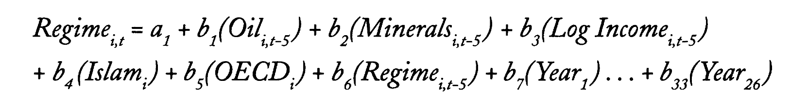

# Data needed

## Ross 2001

### Regime

DATA: Polity 98 Data (Polity5 Dataset)

https://www.systemicpeace.org/inscrdata.html

Democracy - Autocracy rebased to 0-10 scale

((Democracy - Autocracy) + 10) / 2

Use either polity data or polity2 data

polity2 converts -77 -88 -99 to useful values

### Oil

Mineral-based fuels as percentage of GDP: 
Petroleum, Natural Gas, coal

DATA: use Worldbank Data (use rents? even though it only covers oil)

https://data.worldbank.org/indicator/NY.ADJ.NNTY.PC.CD

Watch for Trinidad and Singapore as they need to be corrected being exporters for nearby states (see App.1)

### Minerals

non-fuel minerals as perc of GDP under SITC

DATA: use Worldbank Data (use rents? covers: https://databank.worldbank.org/metadataglossary/world-development-indicators/series/NY.GDP.MINR.RT.ZS)

https://data.worldbank.org/indicator/NY.GDP.MINR.RT.ZS

Watch for Trinidad and Singapore as they need to be corrected being exporters for nearby states (see App.1)

### Log Income

natural log of per capita income 
    
DATA: use Worldbank Data

https://data.worldbank.org/indicator/NY.ADJ.NNTY.PC.CD

### Islam

percentage of professed religion islam in 1970

DATA: ???

https://www.pewresearch.org/dataset/dataset-of-global-religious-composition-estimates-for-2010-and-2020/

### OECD

OECD is a dummy variable coded 1 for the following states and 0 for all others: Australia, Austria, Belgium, Canada, Denmark, Finland, France, Germany, Greece, Iceland, Ireland, Italy, Japan, Luxembourg, Netherlands, New Zealand, Norway, Portugal

### Regime

dependency variable (regime) lagged by 5 years

### Year ... Year

obv the year

